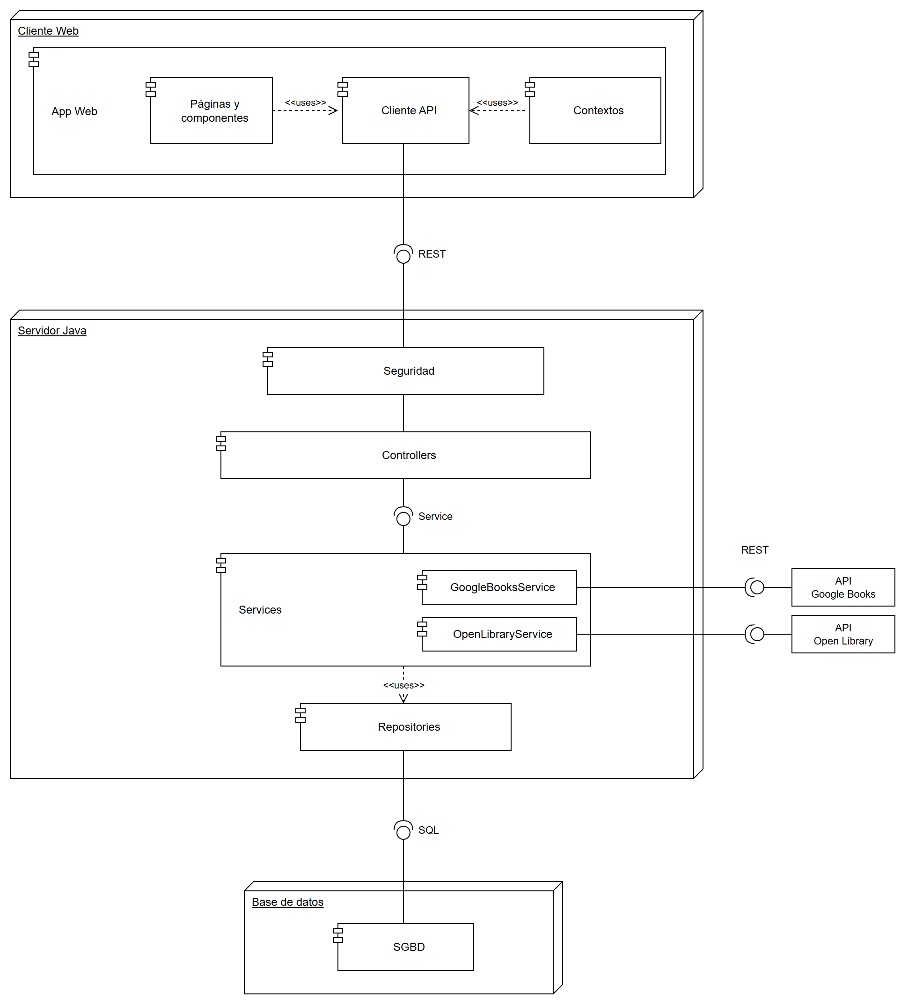

# Bookmark

Red social de lectura desarrollada como Trabajo de Fin de Grado. Permite seguir tus lecturas libro a libro, mantener una racha diaria, participar en retos, escribir reseñas, guardar citas, crear listas y ver qué leen las personas a las que sigues.

**Demo:** [bookmark-tau-ten.vercel.app](https://bookmark-tau-ten.vercel.app)

## Funcionalidades

- **Ciclo de lectura**: Quiero leer → Leyendo (con progreso por página) → Leído o Abandonado, con historial completo y relecturas.
- **Catálogo y búsqueda**: búsqueda sin tildes en el catálogo propio y, si no basta, en Google Books con importación bajo demanda. Las fichas de autor se completan con Open Library.
- **Racha de lectura** con protectores, **retos** (personales, compartidos, predefinidos y colaborativos) y **sesiones cronometradas** que se pausan al cambiar de pestaña.
- **Social**: reseñas con etiquetas y spoilers, citas con likes y mural, listas, seguidores, actividad de los seguidos, recomendaciones y notificaciones.
- **Administración**: carga masiva de libros por categoría y gestión del catálogo.

## Stack

| Capa | Tecnologías |
| --- | --- |
| Backend | Java 21, Spring Boot 4 (Web MVC, Data JPA, Security, Validation), JWT (jjwt), Lombok |
| Base de datos | PostgreSQL (extensión `unaccent`) |
| Frontend | React 19, Vite, Tailwind CSS 4, React Router 7, Axios |
| Pruebas | JUnit 5, Mockito, AssertJ |
| Despliegue | Docker + Render (backend), Vercel (frontend), Neon (PostgreSQL) |

## Arquitectura



Arquitectura cliente-servidor en tres capas: una SPA en React consume una API REST sin estado (autenticación con JWT) organizada en controladores, servicios y repositorios. El modelo de datos completo está en [`DiagramaER_completo.drawio.png`](DiagramaER_completo.drawio.png).

```
src/main/java/com/readingapp/reading_app/
├── config/       Seguridad, filtro JWT, CORS, errores globales, beans
├── controller/   Endpoints REST
├── service/      Lógica de negocio
├── repository/   Acceso a datos (Spring Data JPA)
├── model/        Entidades JPA y enums
└── dto/          Objetos de petición y respuesta
frontend/src/
├── api/          Instancia de Axios con interceptores
├── context/      Estado global (sesión, racha, notificaciones, avisos)
├── pages/        Una página por ruta
├── components/   Componentes reutilizables
└── utils/        Funciones auxiliares
```

## Ejecutar en local

### Requisitos

- Java 21
- Node.js 20.19 o superior (lo exige Vite 8)
- PostgreSQL
- Una clave de la [API de Google Books](https://developers.google.com/books/docs/v1/using#APIKey). La variable es obligatoria para arrancar; con un valor cualquiera la aplicación funciona, pero solo busca en el catálogo local

### 1. Base de datos

```sql
CREATE DATABASE readingapp;
\c readingapp
CREATE EXTENSION IF NOT EXISTS unaccent;
```

Las tablas las crea Hibernate al arrancar. El catálogo empieza vacío y se llena al buscar libros (se importan de Google Books) o con la carga masiva del panel de administración.

### 2. Backend

La configuración se lee de variables de entorno:

| Variable | Obligatoria | Descripción |
| --- | --- | --- |
| `DATABASE_URL` | No | URL JDBC (por defecto `jdbc:postgresql://localhost:5432/readingapp`) |
| `DB_USERNAME` | No | Usuario de PostgreSQL (por defecto `postgres`) |
| `DB_PASSWORD` | Sí | Contraseña de PostgreSQL |
| `JWT_SECRET` | Sí | Clave para firmar los tokens, de al menos 32 caracteres |
| `GOOGLE_BOOKS_KEY` | Sí | Clave de la API de Google Books |
| `JWT_EXPIRATION` | No | Caducidad del token en ms (por defecto 24 h) |
| `PORT` | No | Puerto del servidor (por defecto 8080) |

Como alternativa, se puede copiar `src/main/resources/application.properties.example` a `application-local.properties`, rellenarlo y arrancar con el perfil `local`.

```bash
./mvnw spring-boot:run
# o con el perfil local:
./mvnw spring-boot:run -Dspring-boot.run.profiles=local
```

La API queda en `http://localhost:8080/api` y su documentación en `http://localhost:8080/swagger-ui.html`.

### 3. Frontend

```bash
cd frontend
npm install
npm run dev
```

Se abre en `http://localhost:5173`. Para apuntar a otro backend, define `VITE_API_URL` (por ejemplo, en `frontend/.env.local`).

## Pruebas

```bash
./mvnw test
```

257 pruebas unitarias de los servicios con JUnit 5 y Mockito. No necesitan base de datos.

## Despliegue

- **Backend**: imagen Docker multi-etapa (`Dockerfile`) desplegada en Render. Las variables de entorno anteriores se configuran en el panel de Render.
- **Frontend**: Vercel, con `VITE_API_URL` apuntando al backend. `frontend/vercel.json` redirige todas las rutas a `index.html` para que funcione React Router.
- **Base de datos**: PostgreSQL gestionado en Neon.

## Autor

Emilio José Pulpeiro Rodríguez, Trabajo de Fin de Grado (2026).
